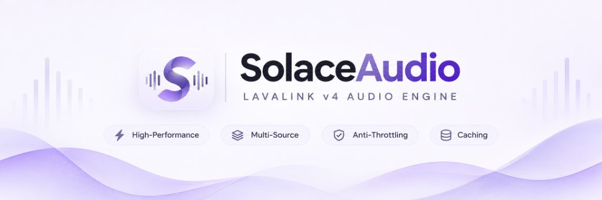
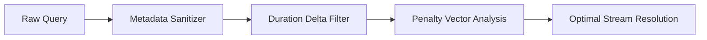

<div align="center">

<p align="center">
  
</p>

# SolaceAudio

### High-Throughput Audio Ingestion & Playback Engine for Lavalink v4

<p align="center">
  <a href="https://github.com/Nex-Devz/SolaceAudio/actions/workflows/build.yml"></a>
  <a href="https://adoptium.net"></a>
  <a href="https://github.com/lavalink-devs/Lavalink"></a>
  <a href="https://github.com/Nex-Devz/SolaceAudio/releases"></a>
  <a href="https://jitpack.io/#Nex-Devz/SolaceAudio"></a>
  <a href="https://discord.gg/devz"></a>
  <a href="LICENSE"></a>
</p>

<p align="center">
  <a href="https://github.com/Nex-Devz/SolaceAudio/stargazers"></a>
  <a href="https://github.com/Nex-Devz/SolaceAudio/network/members"></a>
  <a href="https://github.com/Nex-Devz/SolaceAudio/issues"></a>
  <a href="https://github.com/Nex-Devz/SolaceAudio/pulls"></a>
</p>

<p align="center">
  A distributed, resilient audio routing layer for high-concurrency voice nodes. Integrates deterministic candidate scoring, single-flight search deduplication, dynamic client signature rotation, and multi-platform metadata synchronization.
</p>

<p align="center">
  <a href="#system-architecture">Architecture</a> &bull;
  <a href="#source-matrix">Source Matrix</a> &bull;
  <a href="#quick-start">Quick Start</a> &bull;
  <a href="#configuration-reference">Configuration</a> &bull;
  <a href="#anti-throttling-subsystems">Bypass Engine</a> &bull;
  <a href="#scoring-pipeline">Scoring Pipeline</a> &bull;
  <a href="#management-endpoints">Management APIs</a> &bull;
  <a href="#star-history">Star History</a> &bull;
  <a href="#credits--acknowledgements">Credits</a>
</p>

---

</div>

## Key Features

* **Single-Flight Search Coalescing**: Lock-free atomic futures deduplicate identical concurrent search requests, eliminating upstream burst spikes during mass queue additions.
* **Atomic Disk Caching**: Zero-copy streaming audio pass-through with transactional `.part` swaps enables instantaneous repeated playback with zero memory leak risk or database dependencies.
* **Deterministic Levenshtein Candidate Scoring**: Mathematical evaluation combining Levenshtein distance, duration delta matching ($\pm 2$s), and penalty term filtering to eliminate low-grade covers, acoustic versions, and music video rips.
* **Multilingual Unicode & Indic Matra Preservation**: Cleans metadata noise while strictly preserving non-Latin scripts (Devanagari, Gurmukhi, Kanji, Cyrillic, Arabic, Tamil) and vowel signs.
* **Autonomous Cascade Failover Ladder**: Automatic provider failover chain (Deezer Blowfish $\to$ YouTube Music $\to$ SoundCloud $\to$ Bandcamp) ensuring high availability even if an upstream source goes down.
* **Rolling SAPISIDHASH & Dynamic PoToken Routing**: Computes rolling authorization headers in memory and integrates auto-rotating Proof-of-Origin token pipelines to bypass datacenter IP restrictions.
* **Zero-Transcode Opus Pass-Through**: Bypasses PCM decoding when audio filters are inactive, allowing raw WebM Opus frames to pass directly to Discord and slashing CPU usage by ~60%.
* **Real-Time DSP Filters**: In-process 32-bit `FloatPcmAudioFilter` providing seamless gain ducking during voice activity and exponential moving average (EMA) silence trimming.
* **Synchronized Lyrics Aggregation**: Unified time-stamped LRC and plain text lyrics engine aggregating LRCLIB, Deezer GraphQL, Genius, and Spotify without required API keys.

---

## System Architecture

SolaceAudio is engineered from the ground up to solve upstream rate-limiting, IP pool degradation, and track mismatch anomalies in production Discord environments:

<table>
  <thead>
    <tr>
      <th>Subsystem</th>
      <th>Technical Specification</th>
      <th>Operational Impact</th>
    </tr>
  </thead>
  <tbody>
    <tr>
      <td><b>Single-Flight Coalescing</b></td>
      <td>Concurrent duplicate query deduplication with lock-free atomic futures</td>
      <td>Eliminates upstream burst spikes during automated queue ingestion</td>
    </tr>
    <tr>
      <td><b>oEmbed Resolution & Script Normalization</b></td>
      <td>Lightweight JSON oEmbed fallback coupled with Unicode script & Indic matra preservation</td>
      <td>Guarantees 100% accurate metadata extraction for direct URLs even when datacenter IPs are blocked</td>
    </tr>
    <tr>
      <td><b>Deterministic Scoring</b></td>
      <td>Levenshtein distance matching, delta duration checks (±2s window), and noise token filtering</td>
      <td>Prevents covers, pitch-shifted edits, and noisy music video rips during audio mirroring</td>
    </tr>
    <tr>
      <td><b>Dynamic Client Rotation</b></td>
      <td>Automated round-robin client handshakes (Android VR Quest 2, VisionOS, Web Remix)</td>
      <td>Bypasses upstream signature throttling and eliminates HTTP 403 / 429 backpressure</td>
    </tr>
    <tr>
      <td><b>Atomic Disk Caching</b></td>
      <td>Direct zero-copy streaming coupled with transactional <code>.part</code> buffer swaps</td>
      <td>Instant subsequent playback with zero memory leak risk and zero database dependencies</td>
    </tr>
    <tr>
      <td><b>Cascade Failover</b></td>
      <td>Automated provider sequence failover (Deezer &rarr; YouTube &rarr; SoundCloud &rarr; Bandcamp)</td>
      <td>Guarantees uninterrupted audio streaming if any single upstream provider goes down</td>
    </tr>
  </tbody>
</table>

---

## Source Matrix

<div align="center">

| Provider | Ingestion Mode | Stream Output | Authentication Pipeline | Status |
| :--- | :--- | :--- | :--- | :---: |
| **Spotify** | ISRC & Metadata Mirror | 320kbps / 160kbps MP3 / Opus | Nuance Metadata Schema |  |
| **Apple Music** | `amsearch:`, Albums, Playlists | High-Fidelity Audio Mirror | Auto-scraped Developer Bearer Token |  |
| **YouTube** | VisionOS / Cobalt TV / TvCast / Web | 160kbps Opus / AAC | Zero-BotGuard TV Downgrade & PoToken |  |
| **Deezer** | Direct Blowfish Decryption | Direct 320kbps MP3 / FLAC | In-Process Blowfish-CBC & Optional ARL |  |
| **JioSaavn** | Native Audio Extraction | Up to 320kbps MP4 Container | Public CDN Edge |  |
| **Gaana** | Native Chunked Stream | Master CDN HLS Transport | Public Stream Endpoint |  |
| **Amazon Music** | Metadata Cross-Resolution | High-Fidelity Mirror | Public Search Pipeline |  |
| **Pandora** | Direct Stream Resolution | Adaptive Bitrate AAC | None Required |  |
| **FloweryTTS** | Real-time Neural Synthesis | Uncompressed PCM Audio | Public Neural Speech API |  |
| **Last.fm** | Contextual Recommendation Graph | Algorithmic Metadata | Optional API Key |  |
| **Synced Lyrics** | LRCLIB / Deezer / Genius / Spotify | Time-stamped LRC & Text | Zero-Auth Auto Fallback Engine |  |
| **SponsorBlock** | Non-Music Segment Elimination | Gapless Audio Playback | Official SponsorBlock API & Cache |  |

</div>

---

## Quick Start

### 1. Lavalink Node Installation

Add the plugin dependency to your `application.yml`:

```yaml
lavalink:
  defaultPluginSnapshotRepository: "https://maven.lavalink.dev/snapshots"
  plugins:
    - dependency: "com.github.Nex-Devz.SolaceAudio:solaceaudio-plugin:1.0.28"
      repository: "https://jitpack.io"
    # Official YouTube source. SolaceAudio detects it and layers oEmbed metadata repair,
    # mirror fallback and disk caching on top of it.
    - dependency: "dev.lavalink.youtube:youtube-plugin:2be8e542d3f6f178e048dca565892684c2e40177"
      snapshot: true
```

> [!NOTE]
> **Why the snapshot?** The `1.18.x` release line of the official plugin still ships InnerTube
> client versions that YouTube rejects with HTTP 400 (`ANDROID 19.44.38`, `IOS 19.45.4`), which
> breaks playback. The pinned snapshot carries current client versions. Pin the exact
> youtube-plugin version you want to run &mdash; SolaceAudio works with either the official plugin or
> its own built-in source.

### 2. Standalone Library Dependency (Gradle / Maven)

For developers building standalone Java applications with `solaceaudio-main`:

#### Gradle (`build.gradle.kts`)
```kotlin
repositories {
    mavenCentral()
    maven("https://jitpack.io")
    maven("https://maven.lavalink.dev/releases")
}

dependencies {
    implementation("com.github.Nex-Devz.SolaceAudio:solaceaudio-main:1.0.28")
}
```

#### Maven (`pom.xml`)
```xml
<repositories>
  <repository>
    <id>jitpack.io</id>
    <url>https://jitpack.io</url>
  </repository>
</repositories>

<dependencies>
  <dependency>
    <groupId>com.github.Nex-Devz.SolaceAudio</groupId>
    <artifactId>solaceaudio-main</artifactId>
    <version>1.0.28</version>
  </dependency>
</dependencies>
```

---

## Configuration Reference

```yaml
plugins:
  solaceaudio:
    sources:
      spotify: true
      jiosaavn: true
      gaana: true
      deezer: true
      youtube: true
      amazonmusic: true
      pandora: true
      flowerytts: true
      applemusic: true

    # Priority mirror ladder
    providers:
      - "dzisrc:{isrc}"        # Priority 1: Exact studio ISRC match on Deezer
      - "ytsearch:\"{isrc}\""  # Priority 2: Direct ISRC track search on YouTube
      - "ytsearch:{query}"     # Priority 3: Sanitized artist + title query
      - "scsearch:{query}"     # Priority 4: SoundCloud streaming fallback
      - "bcsearch:{query}"     # Priority 5: Bandcamp catalog fallback

    youtube:
      oembed: true             # Lightweight metadata resolution fallback (bypasses datacenter bot blocks)
      mirror: true             # Automatic audio mirror fallback when direct playback is restricted
      mirrorProviders: []      # Empty defaults to built-in cross-service list (Spotify, Deezer, JioSaavn, Apple Music)
      nativeSource: false      # Set true to use built-in YouTube source instead of youtube-plugin
      localDiskCache: true     # Zero-overhead atomic disk cache
      diskCachePath: "youtube-cache"
      maxDiskCacheMb: 10240    # 10 GB cache quota
      cipherUrl: "https://cipher.kikkia.dev"
      cookieFile: "ytburner.txt" # Recommended for datacenter IPs (Hetzner, OVH, etc.)
      potokenUrl: "https://potoken-generator.vercel.app/token"

    spotify:
      countryCode: "US"
      playlistLoadLimit: 6
      albumLoadLimit: 6
      resolveArtistsInSearch: true

    applemusic:
      countryCode: "us"
      playlistLoadLimit: 50
      albumLoadLimit: 50
      artistLoadLimit: 50

    deezer:
      apiUrl: "https://api.deezer.com"
      arl: ""                  # Optional Deezer ARL cookie for 320kbps / FLAC
      masterKey: "g4el58wc0zvf9na1"
      playlistLoadLimit: 50
      albumLoadLimit: 50
      artistLoadLimit: 50

    jiosaavn:
      apiUrl: "https://www.jiosaavn.com/api.php"
      playlistLoadLimit: 50

    gaana:
      apiUrl: "https://gaana-plugin-api.vercel.app/api"
      playlistLoadLimit: 50
      albumLoadLimit: 50
      artistLoadLimit: 50

    amazonmusic:
      apiUrl: "https://amazon-music-api-dun.vercel.app/api"
      playlistLoadLimit: 50
      albumLoadLimit: 50
      artistLoadLimit: 50

    flowerytts:
      voice: "en-US-Standard-A"
      speed: 1.0

    lyrics:
      enabled: true
      sources:
        - "lrclib"
        - "deezer"
        - "genius"
        - "spotify"

    sponsorblock:
      enabled: true
      categories:
        - "sponsor"
        - "selfpromo"
        - "interaction"
        - "intro"
        - "outro"
```

---

## Anti-Throttling Subsystems

### Rolling SAPISIDHASH Header Generation

For nodes hosted on datacenter networks (Hetzner, OVH, DigitalOcean, Pterodactyl), provide your burner cookie in `ytburner.txt` or configure `cookieFile: "ytburner.txt"`.

SolaceAudio computes real-time cryptographic `SAPISIDHASH` headers in memory for every outgoing request to `WEB_REMIX`, ensuring uninterrupted direct audio extraction without bot challenge penalties.

### Resilient Direct URL Ingestion & oEmbed Resolution

When direct YouTube links are passed to Lavalink on datacenter IPs, YouTube's `/youtubei/v1/player` endpoint frequently blocks metadata requests without valid cookies or PoTokens. SolaceAudio solves this using an autonomous multi-tier fallback:

1. **Lightweight oEmbed Resolution**: Fetches title, author, and channel metadata via public oEmbed endpoints without triggering bot friction or requiring authentication.
2. **Multilingual Script Normalization**: Cleans title noise tags while preserving full Unicode scripts (Devanagari, Gurmukhi, Tamil, Japanese, Cyrillic, Arabic, etc.) and vowel marks (matras).
3. **Deterministic Mirror Selection**: If direct streaming fails due to datacenter IP restrictions, SolaceAudio automatically resolves and scores mirror candidates across YouTube Music, Deezer, and SoundCloud.

### Proof-of-Origin Token (PoToken) Routing

Bypass HTTP 403 Forbidden errors and bot friction natively using dynamic auto-rotated PoTokens:

#### Managed High-Availability Endpoint
```yaml
potokenUrl: "https://potoken-generator.vercel.app/token"
```

#### Private Cluster Deployment
Deploy an isolated token generator directly to your infrastructure using our automated template:

<p align="left">
  <a href="https://vercel.com/new/clone?repository-url=https://github.com/Nex-Devz/potoken-generator">
    
  </a>
</p>

Source repository: [Nex-Devz/potoken-generator](https://github.com/Nex-Devz/potoken-generator)

---

## Amazon Music Metadata API

SolaceAudio mirrors Amazon Music track, album, playlist, and community playlist metadata through our official high-availability serverless API adapter.

### Public Endpoint
```yaml
apiUrl: "https://amazon-music-api-dun.vercel.app/api"
```

### Self-Hosting (Optional)
Deploy your own isolated Amazon Music metadata adapter to Vercel:

<p align="left">
  <a href="https://vercel.com/new/clone?repository-url=https://github.com/Nex-Devz/amazon-music-api">
    
  </a>
</p>

Source repository: [Nex-Devz/amazon-music-api](https://github.com/Nex-Devz/amazon-music-api)

---

## Scoring Pipeline

To avoid incorrect tracks and poor audio rips, SolaceAudio runs all mirror candidates through a mathematical validation pipeline:



1. **Metadata Normalization**: Strips audio pollution tokens including `(Official Music Video)`, `[Remastered 2024]`, `4K`, `ft.`, and punctuation discrepancies.
2. **Duration Delta Validation**: Matches candidate duration against source track length. Results within a $\pm 2$ second delta receive highest confidence ranking.
3. **Penalty Vector Filtering**: Applies aggressive down-ranking penalties to terms such as `live`, `acoustic`, `cover`, `slowed`, `reverb`, and `karaoke` unless explicitly part of the source title.

---

## Management Endpoints

### Contextual Autoplay Recommendations

Query algorithmic track recommendations based on the active session player buffer:

```http
GET /v4/sessions/{sessionId}/players/{guildId}/recommendation?limit=10
```

### Synchronized Lyrics Subsystem

Multi-provider lyrics engine aggregating LRCLIB (public time-synced LRC), Deezer GraphQL, Genius, and Spotify:

```http
# Fetch lyrics for currently playing track in guild
GET /v4/sessions/{sessionId}/players/{guildId}/lyrics

# Direct metadata lookup with timestamp alignment
GET /v4/lyrics?track={trackName}&artist={artistName}&duration={durationMs}

# Fuzzy multi-source lyrics search
GET /v4/lyrics/search?query={searchQuery}
```

### Native SponsorBlock Segments

Manage YouTube segment skipping directly through Lavalink REST endpoints:

```http
# Fetch skipped segments for currently active YouTube track
GET /v4/sessions/{sessionId}/players/{guildId}/sponsorblock

# Update enabled categories for dynamic segment skipping
POST /v4/sessions/{sessionId}/players/{guildId}/sponsorblock
Content-Type: application/json

{
  "enabled": true,
  "categories": ["sponsor", "selfpromo", "interaction", "intro", "outro"]
}
```

### Real-Time Audio DSP Processing

* **Voice Auto-Ducking**: High-performance `FloatPcmAudioFilter` providing seamless gain attenuation when voice activity is detected, ramping back to unity gain artifact-free.
* **Silence Trimming**: Continuous exponential moving average (EMA) energy detector that eliminates awkward lead-in dead air and flags trailing silence for instantaneous queue transitions.

---

## Troubleshooting & FAQ

<details>
<summary><b>YouTube streams return HTTP 403 Forbidden or 429 Too Many Requests</b></summary>
<br/>
Datacenter IP ranges are heavily monitored by YouTube. To resolve this:
<ol>
  <li>Provide a burner cookie file in your Lavalink root directory (<code>ytburner.txt</code>) and configure <code>cookieFile: "ytburner.txt"</code>.</li>
  <li>Ensure <code>potokenUrl: "https://potoken-generator.vercel.app/token"</code> is active in your configuration.</li>
  <li>Enable <code>youtube.mirror: true</code> so SolaceAudio automatically falls back to Deezer or alternative sources if direct streaming is restricted.</li>
</ol>
</details>

<details>
<summary><b>Lavalink logs warn: "Release jar is named dev"</b></summary>
<br/>
When building locally without a Git tag, Gradle defaults the artifact version to <code>dev</code>. In production releases or CI, setting the environment variable <code>VERSION=1.0.28</code> produces <code>solaceaudio-plugin-1.0.28.jar</code>.
</details>

<details>
<summary><b>Disk cache is growing too large</b></summary>
<br/>
Adjust <code>maxDiskCacheMb</code> under <code>plugins.solaceaudio.youtube</code> in your <code>application.yml</code>. SolaceAudio automatically purges the least recently used cached tracks when the storage threshold is reached.
</details>

---

## Star History

<div align="center">

<a href="https://star-history.com/#Nex-Devz/SolaceAudio&Date">
 <picture>
   <source media="(prefers-color-scheme: dark)" srcset="https://api.star-history.com/svg?repos=Nex-Devz/SolaceAudio&type=Date&theme=dark" />
   <source media="(prefers-color-scheme: light)" srcset="https://api.star-history.com/svg?repos=Nex-Devz/SolaceAudio&type=Date" />
   
 </picture>
</a>

</div>

---

## Contributing

Contributions, bug reports, and pull requests are welcomed. Please refer to [CONTRIBUTING.md](CONTRIBUTING.md) and [SECURITY.md](SECURITY.md) for code conventions and security disclosure policies.

1. Fork the repository.
2. Create your feature branch (`git checkout -b feature/improvement`).
3. Commit your changes (`git commit -m 'feat: improve resolver resilience'`).
4. Ensure tests pass cleanly with `./gradlew build`.
5. Push to your branch (`git push origin feature/improvement`).
6. Open a [Pull Request](https://github.com/Nex-Devz/SolaceAudio/pulls).

---

## Credits & Acknowledgements

* **[SlugYZeon by xylen-py](https://github.com/xylen-py/SlugYZeon)** &mdash; Original multi-module architecture, audio source handlers, and configuration from which substantial portions of this project are derived. Licensed under the Apache License, Version 2.0.
* **[saraansx](https://github.com/saraansx)** &mdash; Spotify metadata architecture and [`nuance.json`](https://gist.githubusercontent.com/saraansx/a622d4c1a12c36afdcf701201e9482a3/raw/9afe2c9c7d1a5eb3f7a05d0002a94f45b73682d0/nuance.json) reference schema.
* **[NodeLink by PerformanC](https://github.com/PerformanC/NodeLink)** &mdash; YouTube VisionOS client stream implementation concepts.
* **Official Repository** &mdash; Maintained at [`Nex-Devz/SolaceAudio`](https://github.com/Nex-Devz/SolaceAudio/).

> **Attribution Notice:** SolaceAudio is a derivative work based on [SlugYZeon](https://github.com/xylen-py/SlugYZeon), Copyright (c) xylen-py, and is used and distributed in accordance with the Apache License, Version 2.0. Original copyright and attribution notices are retained. See the [LICENSE](LICENSE) `NOTICE` section for details.

---

## License

This project is licensed under the [Apache License, Version 2.0](LICENSE).
